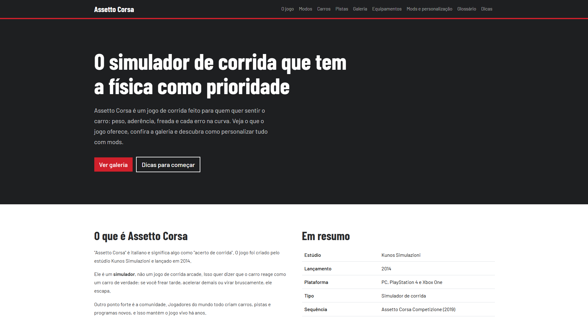

Declaração de uso de Inteligência Artificial

A Inteligência Artificial foi utilizada como ferramenta de apoio em algumas etapas do desenvolvimento deste projeto, principalmente nos momentos em que tive dúvidas sobre a estruturação do código HTML e CSS, como a utilização e o posicionamento de tags, por exemplo as divs.

O objetivo foi auxiliar nas dificuldades encontradas, buscando compreender o funcionamento dos códigos utilizados e aprender com as explicações. A IA não foi utilizada para substituir meu aprendizado, mas sim como um recurso de consulta e orientação durante o desenvolvimento.

